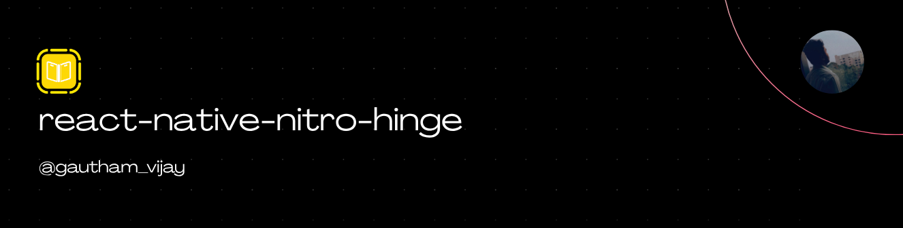
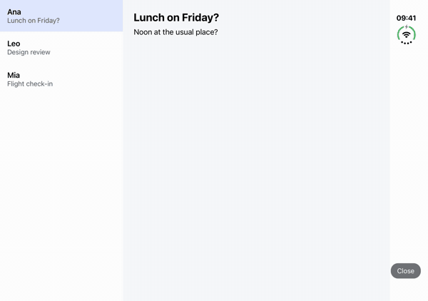
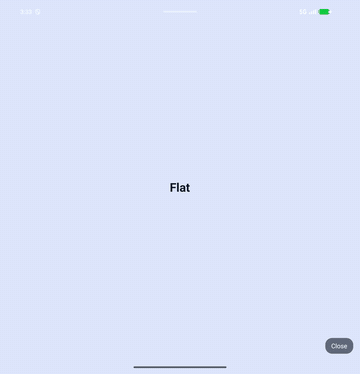
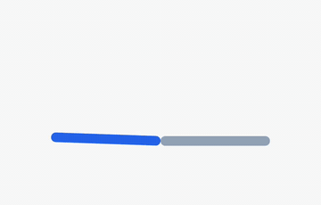
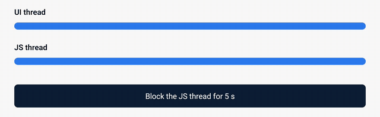

<a href="https://gauthamvijay.com">
  <picture>
    
  </picture>
</a>

# react-native-nitro-hinge

Size class, safe insets, hinge geometry and hinge angle for React Native
on iOS and Android. It's built on Nitro, so every read is synchronous and
works at module load. The same API covers phones, tablets, Android
foldables, tri-folds and the iPhone Duo.

<table>
  <tr>
    <th>iPhone Duo</th>
    <th>Android foldable</th>
  </tr>
  <tr>
    <td></td>
    <td></td>
  </tr>
</table>

## Install

```bash
yarn add react-native-nitro-hinge react-native-nitro-modules
cd ios && pod install
```

Requires React Native 0.75+, Nitro 0.37+, iOS 13.4+ and Android API 24+.
Fold geometry needs iOS 27.1 (Xcode 27.1 beta) on iOS and
`androidx.window` 1.5+ on Android. Without them you still get size class,
safe insets and font scale, and `foldFeatures` stays empty.

`pod install` turns fold detection on when the active Xcode has the iOS
27.1 SDK. Set `HINGE_IOS_27_1_SDK=1` or `0` before `pod install` to force
it either way. After switching to an older Xcode, run `pod install` again,
or the build fails on the 27.1 APIs.

The Reanimated hooks also need `react-native-reanimated` 4 and
`react-native-worklets`. Apps that don't import
`react-native-nitro-hinge/reanimated` don't need either.

## Examples

The code under each GIF is the full screen from the
[example app](./example/src/examples).

### List / detail

Phones show the list. Wide windows, like the inner display of a
foldable, show the open message next to it.


```tsx
import { useState } from 'react';
import { Pressable, Text, View } from 'react-native';
import { useHinge } from 'react-native-nitro-hinge';

const messages = [
  {
    from: 'Ana',
    subject: 'Lunch on Friday?',
    body: 'Noon at the usual place?',
  },
  { from: 'Leo', subject: 'Design review', body: 'Notes from today are up.' },
  { from: 'Mia', subject: 'Flight check-in', body: 'Gate B12, boarding 9:40.' },
] as const;

type Message = (typeof messages)[number];

export function ListDetail() {
  const { widthClass, safeInsets } = useHinge();
  const [open, setOpen] = useState<Message>(messages[0]);
  const wide = widthClass !== 'compact';

  return (
    <View
      style={{
        flex: 1,
        flexDirection: 'row',
        paddingTop: safeInsets.top,
        paddingLeft: safeInsets.left,
        paddingRight: safeInsets.right,
      }}
    >
      <View style={{ flex: 1 }}>
        {messages.map((message) => (
          <Pressable
            key={message.subject}
            onPress={() => setOpen(message)}
            style={{
              padding: 16,
              backgroundColor: wide && message === open ? '#e0e7ff' : 'white',
            }}
          >
            <Text style={{ fontSize: 17, fontWeight: '600' }}>
              {message.from}
            </Text>
            <Text style={{ fontSize: 15, color: '#475569' }}>
              {message.subject}
            </Text>
          </Pressable>
        ))}
      </View>

      {/* Phones show the list. Wide windows show the message next to it. */}
      {wide && (
        <View style={{ flex: 2, padding: 24, backgroundColor: '#f8fafc' }}>
          <Text style={{ fontSize: 24, fontWeight: '700' }}>
            {open.subject}
          </Text>
          <Text style={{ marginTop: 8, fontSize: 17 }}>{open.body}</Text>
        </View>
      )}
    </View>
  );
}
```

### Posture

When the device is half open, the screen splits at the hinge: side by
side in book posture, stacked in tabletop posture.


```tsx
import { Text, View } from 'react-native';
import { useHinge } from 'react-native-nitro-hinge';

// Render this full screen: fold bounds are in window coordinates.
export function Posture() {
  const fold = useHinge((s) =>
    s.foldFeatures.find((f) => f.state === 'halfOpened')
  );

  if (!fold) {
    return <Pane label="Flat" />;
  }

  // Tabletop stacks the panes and book puts them side by side, with the
  // gap on the hinge.
  const tabletop = fold.orientation === 'horizontal';
  const { x, y, width, height } = fold.bounds;

  return (
    <View style={{ flex: 1, flexDirection: tabletop ? 'column' : 'row' }}>
      <View style={tabletop ? { height: y } : { width: x }}>
        <Pane label={tabletop ? 'Video' : 'Page 1'} dark />
      </View>
      <View style={tabletop ? { height } : { width }} />
      <View style={{ flex: 1 }}>
        <Pane label={tabletop ? 'Controls' : 'Page 2'} />
      </View>
    </View>
  );
}

function Pane({ label, dark = false }: { label: string; dark?: boolean }) {
  return (
    <View
      style={{
        flex: 1,
        alignItems: 'center',
        justifyContent: 'center',
        backgroundColor: dark ? '#0f172a' : '#e0e7ff',
      }}
    >
      <Text
        style={{
          fontSize: 28,
          fontWeight: '700',
          color: dark ? 'white' : '#0f172a',
        }}
      >
        {label}
      </Text>
    </View>
  );
}
```

### Lid (Reanimated)

The lid follows the hinge angle on the UI thread.



```tsx
import { View } from 'react-native';
import Animated, { useAnimatedStyle } from 'react-native-reanimated';
import { useAnimatedHingeAngle } from 'react-native-nitro-hinge/reanimated';

export function Lid() {
  const angle = useAnimatedHingeAngle();

  // 180° lies flat, 90° stands up, 0° closes on the base.
  const lid = useAnimatedStyle(() => ({
    transform: [{ rotate: `${180 - (angle.value ?? 180)}deg` }],
  }));

  return (
    <View style={{ flex: 1, alignItems: 'center', justifyContent: 'center' }}>
      <View style={{ flexDirection: 'row' }}>
        <Animated.View
          style={[
            {
              width: 140,
              height: 12,
              borderRadius: 6,
              backgroundColor: '#2563eb',
              transformOrigin: 'right',
            },
            lid,
          ]}
        />
        <View
          style={{
            width: 140,
            height: 12,
            borderRadius: 6,
            backgroundColor: '#94a3b8',
          }}
        />
      </View>
    </View>
  );
}
```

### Blocked JS thread (Reanimated)

Both bars show the hinge angle. The top one reads a shared value, and the
bottom one reads React state. While the JS thread is blocked, only the
top one keeps moving.



```tsx
import { useEffect, useState } from 'react';
import { Pressable, Text, View } from 'react-native';
import Animated, { useAnimatedStyle } from 'react-native-reanimated';
import { hinge } from 'react-native-nitro-hinge';
import { useAnimatedHingeAngle } from 'react-native-nitro-hinge/reanimated';

const track = { height: 16, borderRadius: 8, backgroundColor: '#e2e8f0' };
const bar = { height: 16, borderRadius: 8, backgroundColor: '#2563eb' };

export function BlockedJs() {
  // Updated on the UI thread.
  const angle = useAnimatedHingeAngle();
  const uiBar = useAnimatedStyle(() => ({
    width: `${((angle.value ?? 180) / 180) * 100}%`,
  }));

  // Updated through React state on the JS thread.
  const [jsAngle, setJsAngle] = useState(hinge.hingeAngle);
  useEffect(() => {
    const sub = hinge.addHingeAngleListener(setJsAngle);
    return () => sub.remove();
  }, []);

  const [blocked, setBlocked] = useState(false);
  const blockJs = () => {
    setBlocked(true);
    // Let React paint the button first, then hold the JS thread for 5 s.
    setTimeout(() => {
      const end = Date.now() + 5000;
      while (Date.now() < end) {
        // busy wait
      }
      setBlocked(false);
    }, 50);
  };

  return (
    <View style={{ flex: 1, justifyContent: 'center', padding: 32, gap: 12 }}>
      <Text style={{ fontSize: 17, fontWeight: '600' }}>UI thread</Text>
      <View style={track}>
        <Animated.View style={[bar, uiBar]} />
      </View>

      <Text style={{ fontSize: 17, fontWeight: '600', marginTop: 16 }}>
        JS thread
      </Text>
      <View style={track}>
        <View style={[bar, { width: `${((jsAngle ?? 180) / 180) * 100}%` }]} />
      </View>

      <Pressable
        testID="block-js"
        onPress={blockJs}
        style={{
          marginTop: 32,
          padding: 14,
          borderRadius: 8,
          backgroundColor: blocked ? '#dc2626' : '#0f172a',
        }}
      >
        <Text style={{ color: 'white', fontSize: 17, textAlign: 'center' }}>
          {blocked ? 'JS thread blocked' : 'Block the JS thread for 5 s'}
        </Text>
      </Pressable>
    </View>
  );
}
```

## API

### State

```typescript
hinge.widthClass; // 'compact' | 'medium' | 'expanded'
hinge.heightClass; // 'compact' | 'medium' | 'expanded'
hinge.windowWidth; // measured window width (pt / dp)
hinge.windowHeight; // measured window height
hinge.safeInsets; // { top, right, bottom, left }, often asymmetric on foldables
hinge.foldFeatures; // active folds; empty on non-foldables
hinge.hingeAngle; // degrees, or undefined without a hinge sensor
hinge.fontScale; // OS Dynamic Type / Configuration.fontScale
hinge.deviceInfo; // { platformVersion, model, hasHardwareHinge }, analytics only
```

Each `foldFeatures` entry has `bounds` (window coordinates),
`orientation` (`'vertical' | 'horizontal'`), `state`
(`'flat' | 'halfOpened'`), `occlusionType` and `isSeparating`.

On Android, `safeInsets` is the part of the system bars and display cutout
that overlaps your app's content. With edge-to-edge (forced on Android 15+
for apps targeting SDK 35 or higher) that's the full bar size. When the
content is laid out inside the bars, as on older versions without
edge-to-edge, every inset is 0.

### useHinge

```typescript
const state = useHinge(); // re-renders on any state change
const widthClass = useHinge((s) => s.widthClass); // only when widthClass changes
const size = useHinge(
  (s) => ({ width: s.windowWidth, height: s.windowHeight }),
  shallowEqual // needed when the selector builds a new object
);
```

All callers share one native listener. Fields that didn't change keep
their reference, so `useHinge((s) => s.foldFeatures)` doesn't re-render
when only other fields change.

### Hinge angle

```typescript
const sub = hinge.addHingeAngleListener((angle) => {
  // degrees, or undefined when the window has no hinge
});
sub.remove();
```

Use the angle for animations only. Layout should follow
`foldFeatures[i].state`. The listener can fire every frame while the
hinge moves, so drive an animated value with it rather than React state.
`addChangeListener` and `useHinge` don't fire for angle changes.

On Android the angle comes from the hinge angle sensor (Android 11+), and
on iOS from `UIHingeInteraction` (iOS 27.1+, with `HINGE_IOS_27_1_SDK`).
On devices without either, `hinge.hingeAngle` is undefined.

### Reanimated

```typescript
import {
  useAnimatedHinge, // SharedValue<HingeState>
  useAnimatedHingeAngle, // SharedValue<number | undefined>
  addHingeWorkletListener,
  addHingeAngleWorkletListener,
} from 'react-native-nitro-hinge/reanimated';
```

The UI thread updates both shared values as soon as native reports a
change, without waiting for the JS thread. The two listeners take a
worklet, run it once with the current value and then on every change, and
return a subscription with `remove()`. Tested with Reanimated 4.7 and
worklets 0.13.

### Helpers

```typescript
isCompactWidth(); // phone-shaped layout
isWide(); // tablet-shaped layout (medium or expanded)
hasActiveFold(); // any active fold in the current window
isSeparating(); // any active fold splits content into panes
isTriFold(); // 2+ active folds at once
isBookPosture(); // half open, vertical fold
isTabletopPosture(); // half open, horizontal fold
contentWidth(); // width inside the safe area
contentHeight(); // height inside the safe area

font(16); // size-class bump, respects Dynamic Type
space(16); // scales more for tablets
size(48); // sub-linear, for containers
radius(8); // sub-linear, for corners
icon(24); // same as size
hairline(1); // PixelRatio-aware
responsive({ compact: 1, medium: 2, expanded: 3 });
```

## What it doesn't expose

- No `isIPad()`. The iPhone Duo is a phone, but its inner display needs a
  tablet layout. Ask the window with `isWide()`, not the device.
- No `isFold()` or `isDuo()`. On the outer display the device is still a
  fold, but the app should look like a phone. Use `hasActiveFold()`.
- No pose enum for layout. Lay out by size class and use
  `foldFeatures[i].state` only for book and tabletop arrangements.

## AI agents

The repo has an [Agent Skills](https://agentskills.io) skill with the API,
layout recipes, the Reanimated hooks and setup notes, so coding agents
work from the real API. Add it to your app with:

```bash
npx skills add Gautham495/react-native-nitro-hinge
```

The CLI puts it in `.claude/skills` for Claude Code and `.agents/skills`
for Codex. The skill lives in
[skills/react-native-nitro-hinge](./skills/react-native-nitro-hinge), and
the npm package includes it too.

## More

[docs/foldables.md](./docs/foldables.md) has the devices Hinge covers,
market numbers, per-pose screenshots, the comparison with other
libraries and the roadmap.
[android-foldables-device-metrics.md](./android-foldables-device-metrics.md)
lists measured metrics for Android foldables.

## Credits

Android observation architecture adapted from
[react-native-fold-kit](https://github.com/AlexeyTsutsoev/react-native-fold-kit)
by Alexey Tsutsoev (MIT). Their `WindowFoldSource` design — per-activity
refcounted source, `WindowInfoTrackerCallbackAdapter` over the coroutine flow,
hinge-sensor client separation, version-counter change detection — is the
reference the Nitro Android side is built on.

## 🪪 License

MIT © [**Gautham Vijayan**](https://gauthamvijay.com)

---

Made with ❤️ and [**Nitro Modules**](https://nitro.margelo.com)
