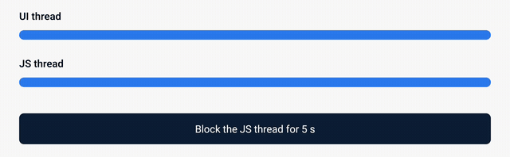

# Blocked JS thread (Reanimated)

Both bars show the hinge angle. The top one reads a shared value, and the
bottom one reads React state. While the JS thread is blocked, only the
top one keeps moving.



```tsx title="BlockedJs.tsx" file=apps/example/src/examples/BlockedJs.tsx
import { useEffect, useState } from 'react';
import { Pressable, Text, View } from 'react-native';
import Animated, { useAnimatedStyle } from 'react-native-reanimated';
import { hinge } from 'react-native-nitro-hinge';
import { useAnimatedHingeAngle } from 'react-native-nitro-hinge/reanimated';

const track = { height: 16, borderRadius: 8, backgroundColor: '#e2e8f0' };
const bar = { height: 16, borderRadius: 8, backgroundColor: '#2563eb' };

export function BlockedJs() {
  // Updated on the UI thread.
  const angle = useAnimatedHingeAngle();
  const uiBar = useAnimatedStyle(() => ({
    width: `${((angle.value ?? 180) / 180) * 100}%`,
  }));

  // Updated through React state on the JS thread.
  const [jsAngle, setJsAngle] = useState(hinge.hingeAngle);
  useEffect(() => {
    const sub = hinge.addHingeAngleListener(setJsAngle);
    return () => sub.remove();
  }, []);

  const [blocked, setBlocked] = useState(false);
  const blockJs = () => {
    setBlocked(true);
    // Let React paint the button first, then hold the JS thread for 5 s.
    setTimeout(() => {
      const end = Date.now() + 5000;
      while (Date.now() < end) {
        // busy wait
      }
      setBlocked(false);
    }, 50);
  };

  return (
    <View style={{ flex: 1, justifyContent: 'center', padding: 32, gap: 12 }}>
      <Text style={{ fontSize: 17, fontWeight: '600' }}>UI thread</Text>
      <View style={track}>
        <Animated.View style={[bar, uiBar]} />
      </View>

      <Text style={{ fontSize: 17, fontWeight: '600', marginTop: 16 }}>
        JS thread
      </Text>
      <View style={track}>
        <View style={[bar, { width: `${((jsAngle ?? 180) / 180) * 100}%` }]} />
      </View>

      <Pressable
        testID="block-js"
        onPress={blockJs}
        style={{
          marginTop: 32,
          padding: 14,
          borderRadius: 8,
          backgroundColor: blocked ? '#dc2626' : '#0f172a',
        }}
      >
        <Text style={{ color: 'white', fontSize: 17, textAlign: 'center' }}>
          {blocked ? 'JS thread blocked' : 'Block the JS thread for 5 s'}
        </Text>
      </Pressable>
    </View>
  );
}
```

[Animations](/reference/animations/) covers the hinge angle, the
Reanimated hooks and the worklet listeners.
