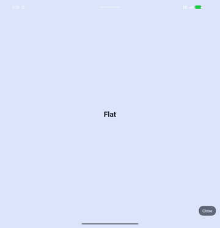

# Posture

When the device is half open, the screen splits at the hinge: side by
side in book posture, stacked in tabletop posture.



```tsx title="Posture.tsx" file=apps/example/src/examples/Posture.tsx
import { Text, View } from 'react-native';
import { useHinge } from 'react-native-nitro-hinge';

// Render this full screen: fold bounds are in window coordinates.
export function Posture() {
  const fold = useHinge((s) =>
    s.foldFeatures.find((f) => f.state === 'halfOpened')
  );

  if (!fold) {
    return <Pane label="Flat" />;
  }

  // Tabletop stacks the panes and book puts them side by side, with the
  // gap on the hinge.
  const tabletop = fold.orientation === 'horizontal';
  const { x, y, width, height } = fold.bounds;

  return (
    <View style={{ flex: 1, flexDirection: tabletop ? 'column' : 'row' }}>
      <View style={tabletop ? { height: y } : { width: x }}>
        <Pane label={tabletop ? 'Video' : 'Page 1'} dark />
      </View>
      <View style={tabletop ? { height } : { width }} />
      <View style={{ flex: 1 }}>
        <Pane label={tabletop ? 'Controls' : 'Page 2'} />
      </View>
    </View>
  );
}

function Pane({ label, dark = false }: { label: string; dark?: boolean }) {
  return (
    <View
      style={{
        flex: 1,
        alignItems: 'center',
        justifyContent: 'center',
        backgroundColor: dark ? '#0f172a' : '#e0e7ff',
      }}
    >
      <Text
        style={{
          fontSize: 28,
          fontWeight: '700',
          color: dark ? 'white' : '#0f172a',
        }}
      >
        {label}
      </Text>
    </View>
  );
}
```

[Layouts](/reference/layouts/) covers panes split at the hinge, tri-folds
and safe insets.
