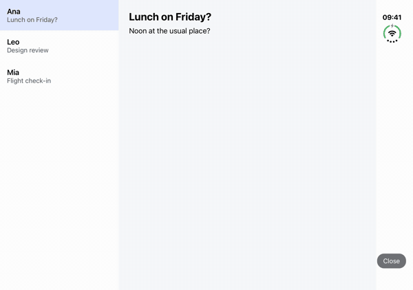
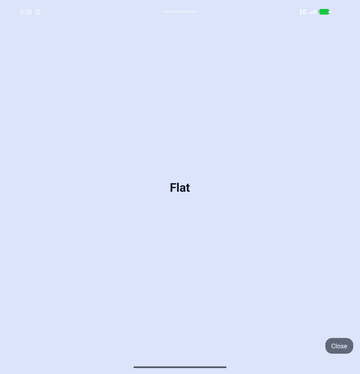

# react-native-nitro-hinge

Size class, safe insets, hinge geometry and hinge angle for React Native
on iOS and Android. It's built on Nitro, so every read is synchronous and
works at module load. The same API covers phones, tablets, Android
foldables, tri-folds and the iPhone Duo.

| iPhone Duo | Android foldable |
| --- | --- |
|  |  |

## Install

```bash
yarn add react-native-nitro-hinge react-native-nitro-modules
cd ios && pod install
```

Requires React Native 0.75+, Nitro 0.37+, iOS 13.4+ and Android API 24+.
Fold geometry needs iOS 27.1 (Xcode 27.1 beta) on iOS and
`androidx.window` 1.5+ on Android. Without them you still get size class,
safe insets and font scale, and `foldFeatures` stays empty.

The Reanimated hooks also need `react-native-reanimated` 4.4 or later and
`react-native-worklets` 0.9 or later. Apps that don't import
`react-native-nitro-hinge/reanimated` don't need either.

[Setup](/reference/setup/) covers the iOS 27.1 SDK flag, testing on
simulators and emulators, and troubleshooting.

## Quick start

```tsx
import { useHinge } from 'react-native-nitro-hinge';

function Screen() {
  const wide = useHinge((s) => s.widthClass !== 'compact');
  return wide ? <TwoPanes /> : <OnePane />;
}
```

`useHinge()` re-renders when the window changes: fold, rotate, Split
View, Stage Manager, Dynamic Type. A selector limits re-renders to the
slice it returns.

## What it doesn't expose

- No `isIPad()`. The iPhone Duo is a phone, but its inner display needs a
  tablet layout. Ask the window with `isWide()`, not the device.
- No `isFold()` or `isDuo()`. On the outer display the device is still a
  fold, but the app should look like a phone. Use `hasActiveFold()`.
- No pose enum for layout. Lay out by size class and use
  `foldFeatures[i].state` only for book and tabletop arrangements.

## Next

- [Examples](/examples/): full screens from the example app.
- [API](/reference/api/): every getter, hook, listener and helper.
- [Layouts](/reference/layouts/) and [Animations](/reference/animations/):
  recipes for size classes, postures and the hinge angle.
- [AI agents](./ai-agents.md): the agent skill and the Markdown files for
  LLMs.
